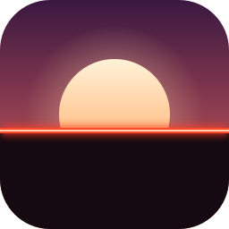

  

<h1 align="center">a s t e r</h1>

  <a href="https://github.com/lennyblk/aster/releases/latest"><b>Download</b></a>

  

 

## Installation

1. Go to the [releases](https://github.com/lennyblk/aster/releases/latest) page.
2. Download the file for your system (Windows or macOS).
3. Launch the game.

**Windows**: if SmartScreen shows a warning, click *More info*, then *Run anyway*.

**macOS**: unzip the archive, then right-click the app and choose *Open* the first time.

 

## Screenshots

<table>
  <tr>
    <td></td>
    <td></td>
  </tr>
  <tr>
    <td></td>
    <td></td>
  </tr>
  <tr>
    <td></td>
    <td></td>
  </tr>
</table>
